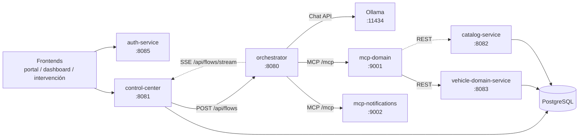
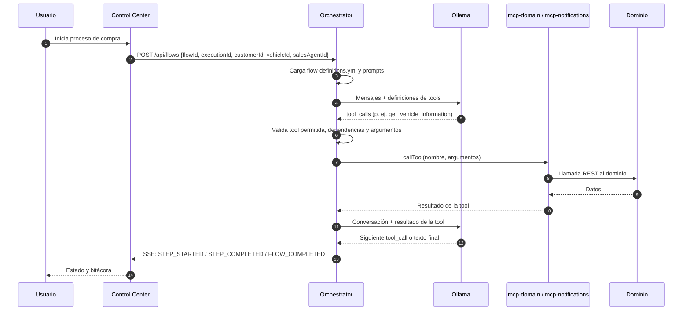

# 1. Arquitectura y flujo completo

## Qué automatiza el sistema

El proyecto ejecuta un proceso comercial de **compra de vehículo**:

1. Consultar la información del vehículo.
2. Registrar la compra.
3. Configurar el método de pago.
4. Enviar un correo con el estado de la compra.

La particularidad es que el orden y los argumentos de esas operaciones los decide
un **LLM local** (Ollama), pero la ejecución real la hace el orquestador llamando
herramientas MCP. El LLM propone; el orquestador valida, ejecuta y registra.

## Servicios y puertos

| Servicio | Tecnología | Puerto | Responsabilidad |
|---|---|---:|---|
| `orchestrator` | Java 21 + Spring Boot + Spring AI | 8080 | Bucle del agente, prompts, llamadas al LLM, ejecución de tools MCP, SSE y estado de pausas |
| `control-center` | Java + PostgreSQL | 8081 | Fuente de verdad del proceso: plantillas, ejecuciones, pasos, bitácora e intervenciones |
| `mcp-domain` | Java + MCP SDK + Feign | 9001 | Expone tools de negocio y las traduce a llamadas REST del dominio |
| `mcp-notifications` | Node.js + MCP SDK | 9002 | Expone la tool de envío de correo |
| `vehicle-domain-service` | Java + JPA | 8083 | Datos de vehículos, órdenes de compra y métodos de pago |
| `catalog-service` | Java + JPA | 8082 | Catálogo de clientes, agentes y servicios |
| `auth-service` | Go + Gin + JWT | 8085 | Login y validación de tokens del portal |
| Ollama | Servicio local | 11434 | Sirve el modelo (`qwen2.5:7b` por defecto) |

## Vista general

## Recorrido de una compra, paso a paso

Detalles importantes del recorrido:

- El **Control Center** es quien normalmente inicia el flujo y aporta el
  `executionId`. Si no lo aporta, el orquestador pide al Control Center una
  plantilla de proceso y crea una ejecución nueva.
- El orquestador **no ejecuta tools dentro del LLM**. Le dice a Spring AI que
  exponga las definiciones, pero intercepta las llamadas y las ejecuta él mismo
  ([AiService.java](../src/main/java/com/floworchestrator/orchestrator/service/AiService.java),
  `internalToolExecutionEnabled(false)`).
- Cada paso completado se publica como evento SSE. El Control Center los consume
  y actualiza la base de datos ([FlowEventSseConsumer.java](../../control-center/src/main/java/com/floworchestrator/controlcenter/service/FlowEventSseConsumer.java)).
- Si falta información o una tool pide intervención, el flujo se **pausa**, se
  guarda el estado y se publica `FLOW_PAUSED`.

## Estados del flujo

El orquestador devuelve un `FlowResponse.status` y, para errores, un `flowCode`.

| Estado / código | Significado |
|---|---|
| `CREATED` | Respuesta recién construida, aún sin ejecutar |
| `COMPLETED` | Todas las tools requeridas se ejecutaron y el LLM dio un cierre |
| `PAUSED_FOR_HUMAN` | Se necesita información del usuario o una tool pidió intervención |
| `FAILED` | Error de negocio, de tool o de configuración; puede reintentarse |
| `CANCELLED` | El flujo se canceló y su estado se descartó; no puede reanudarse |
| `ERR_FLOW_01` | Error genérico del flujo |
| `ERR_FLOW_START` | El flujo asíncrono no pudo arrancar |
| `ERR_LLM_01` | LLM no disponible tras timeouts/reintentos/circuito abierto |

## Ejecución síncrona vs asíncrona

| Modo | Endpoint | Comportamiento |
|---|---|---|
| Síncrono | `POST /api/flows` | Mantiene el hilo HTTP hasta terminar, pausar o fallar |
| Asíncrono | `POST /api/flows/async` | Responde `202 Accepted` al instante y ejecuta en un virtual thread |

El modo síncrono es el que usa hoy el Control Center
([WebClientOrchestratorClient.java](../../control-center/src/main/java/com/floworchestrator/controlcenter/client/WebClientOrchestratorClient.java)).
El asíncrono está disponible para clientes que no quieran mantener una conexión
abierta durante minutos; el progreso se sigue por SSE con el `traceId` devuelto.

## Pausa, reanudación, reintento y cancelación

1. El agente termina un turno pidiendo datos al usuario, o una tool responde
   `requiresIntervention`.
2. El orquestador lanza `RequiresHumanInterventionException`, guarda mensajes y
   estado en `FlowStateManager` y publica `FLOW_PAUSED`.
3. El Control Center crea una **intervención** y la muestra en el frontend.
4. Al resolverla, el Control Center llama a `POST /api/flows/{id}/resume` y puede
   enviar `userInput` con el dato que faltaba.
5. Si se reintenta un paso, primero se marca con
   `POST /api/flows/{id}/steps/{order}/retry`; después se reanuda la ejecución.
6. Si el operador rechaza la intervención, el Control Center marca el proceso
   como cancelado; `POST /api/flows/{id}/cancel` descarta el estado del
   orquestador para que el flujo no pueda reanudarse.
7. El `FLOW_CANCELLED` resultante lo consume el Control Center: si la ejecución
   aún no estaba cancelada la marca con los datos del evento y deja de seguirla;
   si ya estaba cancelada, conserva el mensaje específico del rechazo.

El estado se conserva en memoria y, si `orchestrator.state.directory` no está
vacío, también en disco (`.flow-state/`). Así el `resume` sobrevive a un reinicio.

## Quién hace qué (separación de responsabilidades)

- **LLM**: interpreta el objetivo, elige la siguiente tool y redacta el cierre.
- **Orquestador**: impone reglas, valida argumentos, ejecuta tools, controla
  timeouts, reintentos, pausas y eventos. Nunca confía ciegamente en el LLM.
- **MCP de dominio**: traduce una tool a operaciones del negocio.
- **Dominio**: aplica reglas de datos y persistencia.
- **Control Center**: conserva el estado oficial y la bitácora para la UI.
- **Frontends**: muestran progreso y permiten intervención humana.

## Notas sobre el monorepo

- `services/orchestrator-service` es un servicio TypeScript independiente que no
  participa en el flujo actual ni aparece en `docker-compose.yml`. Se conserva
  como legado.
- El `docker-compose.yml` raíz construye el orquestador, el Control Center, los
  dos servidores MCP y el dominio de vehículos, pero **no** el `catalog-service`
  ni el `auth-service`.
- El orquestador no tiene autenticación propia; se apoya en que el Control Center
  sea el único consumidor interno.
