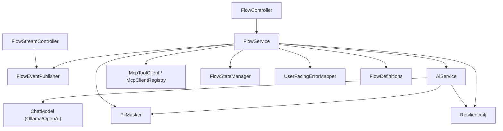

# 3. Guía del código del orquestador

Este documento recorre el servicio `orchestrator` clase por clase. La idea es que
puedas abrir cualquier archivo y saber por qué existe, quién lo llama y qué
efecto tiene en el flujo.

## 3.1 Estructura de paquetes

```text
src/main/java/com/floworchestrator/orchestrator/
├── OrchestratorApplication.java        Arranque de Spring Boot
├── config/
│   ├── FlowDefinitions.java            Mapea flow-definitions.yml a objetos
│   └── OrchestratorConfiguration.java  Beans: ChatModel, WebClient, configuración
├── model/
│   ├── FlowRequest.java                Petición de entrada
│   ├── FlowResponse.java               Respuesta de salida
│   ├── FlowAsyncAccepted.java          Respuesta 202 del modo asíncrono
│   ├── FlowExecutionEvent.java         Evento para SSE
│   └── FlowStepExecution.java          DTO legado, sin uso actual
├── service/
│   ├── AiService.java                  Frontera con el LLM
│   ├── FlowService.java                Orquestador del agente y de las tools
│   ├── FlowServiceConfig.java          Configuración tipada del servicio
│   ├── McpToolClient.java              Puerto para tools MCP
│   ├── McpClientRegistry.java          Adaptador MCP real
│   ├── FlowStateManager.java           Estado de pausas en memoria y disco
│   ├── FlowEventPublisher.java         Publicación de eventos SSE
│   ├── PiiMasker.java                  Enmascarado de datos personales
│   ├── UserFacingErrorMapper.java      Errores técnicos -> mensajes de usuario
│   ├── LlmUnavailableException.java    LLM no disponible
│   └── RequiresHumanInterventionException.java  Pausa para intervención
└── web/controller/
    ├── FlowController.java             Endpoints de flujos
    ├── FlowStreamController.java       Endpoint SSE
    ├── HealthController.java           Health simple
    └── ApiExceptionHandler.java        Traducción de excepciones a HTTP
```

## 3.2 Cómo se conectan



`FlowService` es el centro. `AiService` no conoce el negocio: solo convierte
mensajes, llama al modelo y devuelve una respuesta tipada. `McpClientRegistry` no
conoce el flujo: solo descubre y ejecuta tools.

## 3.3 Recorrido de una petición

### `POST /api/flows` (síncrono)

1. `FlowController.createFlow` recibe un `FlowRequest` validado.
2. `FlowService.createFlow` envuelve la ejecución en un `traceId`.
3. `doCreateFlow`:
   - `selectFlow` valida que el flow exista y que su configuración sea coherente.
   - `resolveExecutionId` usa el `executionId` recibido o lo crea en el Control
     Center.
   - publica `FLOW_STARTED`.
   - `buildPromptMessages` construye system + user.
   - `runAgentLoop` ejecuta el bucle del agente.
   - si algo falla, `handleAgentLoopException` decide si es pausa, LLM caído o
     error normal.

### `POST /api/flows/async`

1. `startFlowAsync` valida el flow **de forma síncrona** (así un `flowId` inválido
   devuelve 400 de inmediato).
2. Genera `traceId` y `requestId`.
3. Envía `doCreateFlow` a un executor de virtual threads.
4. Devuelve `202` con `FlowAsyncAccepted`.
5. Si el arranque falla en segundo plano, publica `FLOW_FAILED` con
   `ERR_FLOW_START`.

### `POST /api/flows/{id}/resume`

1. Recupera el estado pausado (memoria o disco).
2. Si viene `userInput`, lo agrega como mensaje `user`.
3. Publica `FLOW_RESUMED`.
4. Vuelve a ejecutar `runAgentLoop` desde donde quedó.
5. Si vuelve a faltar información, se guarda de nuevo el estado.

### `POST /api/flows/{id}/steps/{order}/retry`

1. Recupera el estado.
2. Verifica que el paso exista y esté marcado como completado/fallido.
3. Lo quita de `completedTools` y marca `currentStep`.
4. Vuelve a guardar el estado.
5. Publica `STEP_RETRY` y responde `RETRYING`.

Importante: **retry no ejecuta el flujo**. Solo prepara el estado para que un
`resume` posterior vuelva a intentar el paso. El cliente debe llamar a `resume`
después.

### `POST /api/flows/{id}/cancel`

1. Recupera y descarta el estado pausado o fallido.
2. Publica `FLOW_CANCELLED` con estado `CANCELLED` y flow code `FLOW_CANCELLED`.
3. Responde `200` con `status = CANCELLED`; si no hay estado almacenado, `404`.

Solo cancela ejecuciones detenidas (pausadas o fallidas): un flujo en ejecución
no se interrumpe a mitad de una herramienta. Se usa cuando el operador rechaza
una intervención humana, para que el estado no pueda reanudarse después.

## 3.4 Clase por clase

### `OrchestratorApplication`

Punto de entrada estándar de Spring Boot. No contiene lógica.

### `FlowDefinitions`

Mapea `flow-definitions.yml` a objetos con `@ConfigurationProperties(prefix =
"orchestrator")`.

```yaml
orchestrator:
  flows:
    compra-vehiculo:
      process-template-name: "Compra de vehiculo"
      system-prompt-template: prompts/compra-vehiculo-system.st
      user-prompt-template: prompts/compra-vehiculo-user.st
      tools:
        - name: get_vehicle_information
          server: mcp-domain
          step-order: 1
          step-name: consultar_vehiculo
          required: true
```

- `flows`: mapa `flowId -> FlowDefinition`.
- `mcpServers`: mapa `nombre lógico -> URL base`.
- `ToolDefinition`: nombre, servidor, orden, nombre visible del paso,
  `required` y `dependsOn`.

Este archivo es la **declaración** del flujo. Cambiar el orden o las dependencias
no requiere tocar Java.

### `OrchestratorConfiguration`

Declara tres beans:

1. `flowServiceConfig`: traduce propiedades sueltas a un record tipado.
2. `chatModel`: construye el `ChatModel` del proveedor activo
   (`OllamaChatModel` u `OpenAiChatModel`) con timeouts reales, opciones por
   defecto y `ToolCallingManager`.
3. `orchestratorWebClient`: `WebClient` con timeout de conexión y respuesta para
   hablar con el Control Center.

El detalle del timeout es importante: `SimpleClientHttpRequestFactory` corta la
lectura HTTP; cancelar un `Future` no aborta necesariamente la conexión.

### `FlowServiceConfig`

Record inmutable con todos los parámetros operativos: URLs, modelo, límites del
agente, timeouts y umbrales de resiliencia. Se construye desde
`OrchestratorConfiguration.flowServiceConfig`.

Tenerlo como record evita pasar 15 `@Value` por todo el código y facilita las
pruebas.

### Modelos

| Clase | Rol |
|---|---|
| `FlowRequest` | Entrada. `flowId` obligatorio; `executionId` opcional; cualquier otro campo JSON se guarda en `attributes` mediante `@JsonAnySetter` |
| `FlowResponse` | Salida. Incluye estado, paso actual, mensajes de error técnicos y amigables, `flowCode`, `traceId`, lista de pasos y atributos |
| `FlowAsyncAccepted` | Respuesta del modo asíncrono: `requestId`, `flowId`, `executionId`, `traceId`, `status=ACCEPTED` |
| `FlowExecutionEvent` | Evento SSE con datos de paso, tool, servidor, error, mensaje de usuario, `flowCode`, `traceId` y timestamp |
| `FlowStepExecution` | DTO de paso. **No se usa actualmente**; el Control Center tiene su propia entidad |

`FlowRequest` es flexible a propósito: el Control Center envía `customerId`,
`vehicleId` y `salesAgentId` como campos de primer nivel, y el orquestador los
trata como atributos de plantilla.

### Controladores

| Endpoint | Método | Descripción |
|---|---|---|
| `/api/flows` | POST | Ejecuta el flujo de forma síncrona |
| `/api/flows/async` | POST | Acepta el flujo y responde 202 |
| `/api/flows/{executionId}/resume` | POST | Reanuda un flujo pausado; acepta `userInput` |
| `/api/flows/{executionId}/steps/{stepOrder}/retry` | POST | Marca un paso para reintento |
| `/api/flows/{executionId}/cancel` | POST | Cancela un flujo pausado/fallido y descarta su estado |
| `/api/flows/stream` | GET | Stream SSE de eventos |
| `/api/flows/health` | GET | Health simple |
| `/api/health` | GET | Health simple alternativo |

`ApiExceptionHandler` traduce:

- `MethodArgumentNotValidException` → 400 con lista de errores de validación.
- `IllegalArgumentException` → 400 `bad_request`.
- `IllegalStateException` → 409 `conflict`.

`FlowStreamController` envuelve cada evento en `ServerSentEvent` con `id`
(`executionId-timestamp`), `event` (tipo) y `data` (el evento completo).

### `AiService`

Es la única clase que habla con el LLM.

Responsabilidades:

1. Convertir `List<Map<String,Object>>` a mensajes de Spring AI.
2. Exponer las tools como `ToolCallback` **sin ejecución interna**.
3. Aplicar timeout, retry y circuit breaker.
4. Extraer texto, `tool_calls` y uso de tokens.
5. Devolver una respuesta degradada si el LLM no está disponible.

Métodos clave:

| Método | Qué hace |
|---|---|
| `generateResponse` | Punto de entrada; decora la llamada con CB + retry |
| `invoke` | Ejecuta la llamada, extrae contenido/tool calls y audita tokens |
| `buildPrompt` | Crea `Prompt` con opciones y tool callbacks |
| `callWithTimeout` | Ejecuta en virtual thread y aplica timeout |
| `toMessages` | Traduce roles `system`, `user`, `assistant`, `tool` |
| `toToolCallbacks` | Convierte `ToolSpec` en `ToolCallback` de solo definición |
| `auditTokens` | Acumula tokens por flujo y globales |
| `parseArguments` | Parsea argumentos JSON; si fallan, devuelve `{}` para que la validación corrija |

El `ToolCallback.call` lanza una excepción a propósito:

```java
throw new IllegalStateException(
        "MCP tools must be executed by the orchestrator, not by the chat model");
```

Así se garantiza que el modelo nunca ejecute código por su cuenta.

Registros internos:

- `AiResponse(content, toolCalls, degraded, flowCode, userMessage, userAction)`.
- `AiToolCall(id, name, arguments)`.
- `ToolSpec(name, description, inputSchema)`.
- `TokenUsage(promptTokens, generationTokens)`.

### `FlowService` (la clase más importante)

Orquesta todo el ciclo de vida. Métodos principales:

| Método | Responsabilidad |
|---|---|
| `createFlow` | Entrada síncrona; asigna `traceId` |
| `startFlowAsync` | Entrada asíncrona; valida y ejecuta en background |
| `resumeFlow` | Recupera estado, inyecta `userInput` y continúa |
| `retryStep` | Prepara un paso para reintento |
| `doCreateFlow` | Flujo completo de una ejecución nueva |
| `doResumeFlow` | Flujo completo de una reanudación |
| `handleAgentLoopException` | Decide pausa, LLM caído o error |
| `buildPromptMessages` | System + user desde plantillas |
| `trimContextIfNeeded` | Recorta conversación larga |
| `runAgentLoop` | Bucle de turnos del agente |
| `processToolCalls` | Procesa una o varias tool calls |
| `executeToolStep` | Ejecuta una tool con resiliencia |
| `executeToolWithRetry` | CB + retry + timeout por servidor |
| `validateToolCall` | Valida dependencias y argumentos |
| `validateArguments` | Compara argumentos con JSON Schema |
| `discoverTool` | Busca la tool en el servidor MCP |
| `getToolSpecs` | Filtra tools disponibles para el modelo |
| `parseToolCallsFromContent` | Fallback para modelos sin tool calling nativo |
| `completeFlow` | Valida tools requeridas y publica `FLOW_COMPLETED` |
| `renderPrompt` | Renderiza StringTemplate |
| `selectFlow` / `validateFlow` | Validan configuración del flujo |

#### Estados internos del agente

`AgentLoopState` guarda:

- `completedTools`: tools ya ejecutadas con éxito;
- `toolResults`: último resultado de cada tool;
- `discoveredByServer`: caché de esquemas MCP (no se persiste);
- `currentStepOrder` y `currentStep`: paso en curso.

`snapshot()` y `fromSnapshot()` permiten serializarlo para la persistencia.

#### Detalle del bucle

```text
para cada turno (máximo maxAgentTurns):
    recortar contexto si hace falta
    calcular tools disponibles (no completadas y con dependencias cumplidas)
    llamar al LLM
    si el LLM está degradado:
        si ya se completaron todas las tools requeridas -> cerrar con resumen
        si no -> lanzar LlmUnavailableException
    agregar respuesta del assistant a la conversación
    si no hay tool calls:
        si el texto pide datos al usuario -> pausar
        si no -> cerrar el flujo (solo si todas las tools requeridas están completas)
    ejecutar tool calls y agregar sus resultados a la conversación
```

#### Validación de argumentos

`validateArguments` toma el `inputSchema` de la tool MCP:

1. Rechaza argumentos que no estén en `properties`.
2. Exige todos los que estén en `required`.
3. Si falla, el mensaje incluye la lista de argumentos permitidos.

El error no se lanza al usuario: se agrega como mensaje de tool para que el LLM
pueda corregir la llamada en el siguiente turno.

#### Reintentos y circuit breaker por servidor MCP

- Nombre del circuito: `mcp-<servidor>`.
- Ventana deslizante de 10 llamadas, mínimo 5.
- Retry con backoff exponencial desde 1 s, factor 2.
- Timeout por paso configurable.

### `McpToolClient` y `McpClientRegistry`

`McpToolClient` es el puerto:

```java
List<DiscoveredTool> listTools(String serverName);
Map<String, Object> callTool(String serverName, String toolName, Map<String, Object> arguments);
```

`McpClientRegistry` es el adaptador real:

- URL por servidor desde `FlowDefinitions.mcpServers`.
- Transporte Streamable HTTP en `/mcp`.
- Un cliente por servidor, creado bajo demanda.
- Si una operación falla, invalida el cliente y reintenta una vez con sesión
  nueva (útil cuando el servidor MCP reinicia).
- Convierte el contenido de texto JSON a `Map`.

### `FlowStateManager`

Guarda `PausedFlowState`:

- `flowId`;
- definición del flujo;
- mensajes de la conversación;
- `AgentLoopState`.

Comportamiento:

- `store`: guarda en memoria y, si hay directorio, escribe JSON.
- `retrieve`: saca de memoria o carga de disco; después **borra** el archivo.
- `hasState`: comprueba memoria o archivo.
- `withExecutionLock` / `runWithExecutionLock`: serializan operaciones por
  `executionId` para evitar reanudaciones concurrentes.

Detalles de persistencia:

- Nombre de archivo: `sha256(executionId).json` (evita path traversal).
- Escritura atómica con archivo temporal y `ATOMIC_MOVE`.
- Si el JSON está corrupto, se registra y se borra.
- `version` permite evolucionar el formato.

### `FlowEventPublisher`

`Sinks.Many` con replay de los últimos 100 eventos. `publish` emite y `stream`
devuelve el `Flux` que consume el controlador SSE.

El replay permite que un suscriptor que llega tarde vea eventos recientes; no es
un historial completo. La fuente de verdad histórica es el Control Center.

### `PiiMasker`

Aplica expresiones regulares para enmascarar:

- correos;
- CURP;
- RFC;
- cuentas de 18 dígitos;
- tarjetas;
- teléfonos.

`maskMap` recorre mapas y listas anidadas. Se usa al loggear contenido del LLM.
No se aplica a los mensajes persistidos en disco: si el estado contiene PII, el
directorio debe protegerse.

### `UserFacingErrorMapper`

Traduce errores técnicos a un mensaje comprensible. Usa una lista ordenada de
patrones (`TIMEOUT`, `CONNECTION_ERROR`, `VALIDATION_ERROR`, etc.) y un mapa de
tools específicas (`set_payment_method`, `search_vehicle`, ...).

Devuelve `ErrorMapping` con:

- `errorCode`;
- `title`;
- `message`;
- `actionLabel`;
- `statusType` (`error`, `warning`, `info`).

### Excepciones

| Excepción | Efecto |
|---|---|
| `RequiresHumanInterventionException` | Pausa el flujo, guarda estado y publica `FLOW_PAUSED` |
| `LlmUnavailableException` | Marca `FAILED` con `ERR_LLM_01`, guarda estado para reintento |
| `IllegalArgumentException` | Validación; normalmente se devuelve al LLM o se traduce a 400 |
| `IllegalStateException` | Error de ejecución; se traduce a 409 o a `FAILED` |

## 3.5 Las pruebas

| Test | Qué cubre |
|---|---|
| `OrchestratorApplicationTests` | Que el contexto de Spring arranque |
| `AiServiceTest` | Conversión de mensajes, tool calls, tokens, timeout y degradación |
| `FlowServiceTest` | Flujo completo, fallback cuando el LLM falla al final, modo asíncrono |
| `FlowServiceResilienceTest` | Validaciones, parser de contenido, pausas, contexto, argumentos permitidos |
| `FlowStateManagerTest` | Estado en memoria y locks |
| `FlowStateManagerPersistenceTest` | Restauración tras “reinicio”, path traversal, archivo corrupto, modo memoria |
| `PiiMaskerTest` | Enmascarado de cada tipo de dato |
| `UserFacingErrorMapperTest` | Mapeo de errores a mensajes |
| `FlowControllerTest` | Respuesta 202 del endpoint asíncrono |
| `McpClientRegistryIntegrationTest` | Integración real con `mcp-notifications` (requiere el servicio levantado) |

Comando recomendado para la suite unitaria:

```bash
mvn -o test -Dtest='!McpClientRegistryIntegrationTest'
```

## 3.6 Recetas para extender el proyecto

### Agregar una tool MCP nueva

1. Implementarla en `mcp-domain` o `mcp-notifications`.
2. Publicarla con nombre, descripción y JSON Schema.
3. Declararla en `flow-definitions.yml` con `server`, `step-order`,
   `step-name`, `required` y `depends-on`.
4. Si necesita un mapeo de error amigable, agregarlo en `UserFacingErrorMapper`.
5. Agregar pruebas del flujo.

### Agregar un flujo nuevo

1. Crear `orchestrator.flows.<nuevo-id>` en `flow-definitions.yml`.
2. Crear sus prompts en `src/main/resources/prompts/`.
3. Declarar sus tools y dependencias.
4. Verificar que los servidores MCP estén en `orchestrator.mcp-servers`.
5. Probar con `POST /api/flows`.

### Cambiar el proveedor, el modelo o la latencia

- Proveedor: `llm.provider` (`ollama` u `openai`) o variable `LLM_PROVIDER`.
  Con `openai` se exige `OPENAI_API_KEY` y se ignora la configuración de Ollama.
- Modelo: `ollama.model` / `OLLAMA_MODEL` u `openai.model` / `OPENAI_MODEL`,
  según el proveedor activo.
- URL de Ollama: `ollama.base-url` o `OLLAMA_BASE_URL`.
- Timeout: `ollama.timeout-seconds` u `openai.timeout-seconds`.
- Turnos: `ollama.max-agent-turns`.
- Contexto: `ollama.max-context-messages`.

Los límites de turnos, contexto, reintentos y umbrales conservan el prefijo
`ollama.*`, pero aplican a cualquiera de los dos proveedores.

### Ajustar resiliencia

- LLM: bloque `resilience4j.circuitbreaker.instances.llm` y
  `resilience4j.retry.instances.llm`.
- MCP: `mcp.max-retries`, `mcp.step-timeout-seconds`,
  `mcp.circuit-breaker-threshold`, `mcp.circuit-breaker-reset-seconds`.

## 3.7 Detalles y trampas conocidas

Los puntos 2 y 3 se habían documentado como deuda técnica y ya están
corregidos; abajo se describe el comportamiento actual.

1. **El Control Center usa el endpoint síncrono.** El endpoint asíncrono existe,
   pero `WebClientOrchestratorClient.startFlow` sigue llamando a `/api/flows`.
   Para aprovecharlo hay que cambiar el cliente y adaptar el consumo de eventos.
2. **La intervención reanuda con datos (corregido).** `InterventionController`
   envía las notas del operador como `userInput` (`"APPROVED"` o
   `"APPROVED. <notas>"`) y llama a `resumeOrRestartFlow`: si el Orchestrator
   conserva el estado pausado, reanuda; si lo perdió (por ejemplo, tras un
   reinicio), reinicia el flujo desde el principio en lugar de dejar el proceso
   detenido con un 200 silencioso.
3. **Retry valida antes de consumir el estado (corregido).** En el Orchestrator,
   `retryStep` solo prepara el paso y la ejecución ocurre en la reanudación
   posterior —el Control Center la hace en el mismo `retryProcess`—. La consulta
   del estado pausado usa `FlowStateManager.peek`, así que un `stepOrder`
   inexistente o un paso sin ejecución previa lanza error sin borrar el flujo
   pausado.
4. **`step=null` en algunas pausas.** `resetCurrentStep` limpia el paso después de
   cada tool. Si el LLM pide datos entre pasos, la pausa se registra sin paso.
5. **`FlowStepExecution` no se usa.** Es un DTO legado; no confundirlo con las
   entidades del Control Center.
6. **Métricas de tokens en memoria.** Se pierden al reiniciar y no hay endpoint
   que las exponga.
7. **El estado persistido contiene mensajes crudos.** Puede incluir PII. Protege
   `.flow-state/` y no lo subas a git.
8. **El parser de tool calls en texto es frágil.** Solo debe usarse como fallback
   para modelos que no emiten `tool_calls` nativos.
9. **No hay autenticación en el orquestador.** Está pensado para red interna;
   no lo expongas directamente a Internet.
